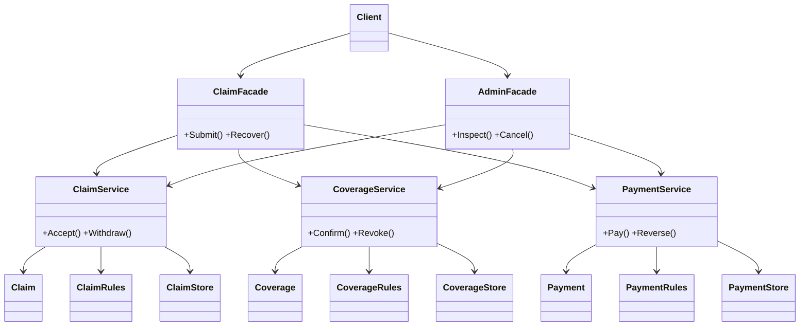

# Assignment 4 — Facade over a 3-stage chain (Go) — Insurance Claims (variant 17)

Customer submits a claim (A) → policy is checked (B) → payout is made (C).

## Files
- `main.go` — everything: three subsystems, two facades, demo menu
- `main_test.go` — all tests (Go requires tests to be in a `_test.go` file)

Inside `main.go`:
| Part | Types |
|---|---|
| A claim intake | `Claim` (entity), `ClaimRules` (logic), `ClaimStore` (JSON gateway), `ClaimService` |
| B policy check | `Coverage`, `CoverageRules`, `CoverageStore`, `CoverageService` |
| C payout | `Payment`, `PaymentRules`, `PaymentStore`, `PaymentService` |
| Facades | `ClaimFacade` (`Submit`, `Recover`), `AdminFacade` (`Inspect`, `Cancel`) |

A, B and C never reference each other's types; only the facades use all three.

## Run
```
go run .                                  # demo menu
go test -cover                            # tests + coverage
```
**Reset data:** menu option 6, or delete the `data/` folder.
Coverage uses Go's built-in tool (equivalent of JaCoCo).

## Statuses and failures
| Subsystem | Statuses | Realistic failure |
|---|---|---|
| A | NEW → ACCEPTED → WITHDRAWN | no documents (`nodocs`), empty input, duplicate claim → nothing saved |
| B | NEW → CONFIRMED → REVOKED | policy lapsed (`lapsed`), claim type not covered (`flood`) → withdraw A |
| C | NEW → PAID → REVERSED | bank account frozen (`frozen`) → revoke B, then withdraw A |

Data lives in `data/*.json`. The chain status (`PENDING_B`, `PENDING_C`, `COMPLETED`, `COMPENSATED`) is saved
after every step; compensation is chosen from the status **read from disk**. `Recover()` runs at startup and
compensates chains left half-done.

## Demo script
1. `1` → alice, theft → COMPLETED
2. `3` → B fails, only A undone
3. `4` → C fails, B undone then A
4. `1` → nodocs, theft → fails at A, nothing saved
5. `2` → inspect state; `5` → cancel a chain manually

## Principle of Least Knowledge
Before (client knows 3 subsystems, their order and the undo rules):
```go
aid, err := a.Accept(customer, kind)
if err != nil { return err }
bid, err := b.Confirm(customer, kind)
if err != nil { a.Withdraw(aid); return err }
_, err = c.Pay(customer, kind)
if err != nil { b.Revoke(bid); a.Withdraw(aid); return err }
```
After (client knows one facade):
```go
chain, err := claimFacade.Submit(customer, kind)
```

## Facade vs Adapter
An Adapter changes the interface of one class so it fits what a client expects; its intent is compatibility.
Here A, B and C already have clean interfaces, nothing needs converting. The problem is that three independent
subsystems must be called in a fixed order and a failure in the middle must undo the right part. The intent is to
hide a workflow behind one operation (`Submit`), which is a Facade. An Adapter would reshape one subsystem and
leave ordering and compensation to the client.

## UML (paste into https://mermaid.live, export PNG/SVG)

